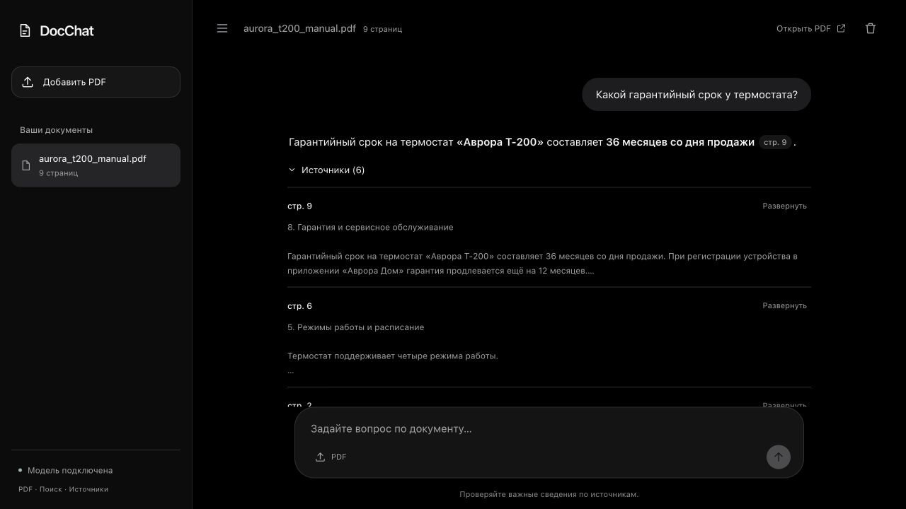

# DocChat

Локальный чат по одному PDF: извлечение текста, гибридный поиск, ответы через LM Studio
и ссылки на страницы. Backend — FastAPI; интерфейс — HTML, CSS и JavaScript без сборки.

Подробная схема: откройте [`architecture.html`](architecture.html) в браузере.
Она работает без сети. Каждый узел раскрывает вход, выход, код и ограничения этапа.

Интерфейс оформлен в чёрных и графитовых тонах: сворачиваемая панель документов,
адаптивный чат и раскрываемые источники. Цитаты и источники доступны с клавиатуры.
Проверка оформления и взаимодействий: [`design-qa.md`](design-qa.md).



## Запуск

Нужны Python 3.11+, [uv](https://docs.astral.sh/uv/) и LM Studio с загруженной чат-моделью.
Для MacBook Air M1 с 8 ГБ RAM проверена Ministral 3 3B Instruct Q4_K_M.

```bash
uv sync --frozen
cp .env.example .env
lms load mistralai/ministral-3-3b --context-length 8192 --parallel 1 --identifier docchat -y
lms server start --port 1234 --bind 127.0.0.1
```

Если модель уже загружена, используйте её ID из `lms ps`; повторная загрузка не нужна.
В `.env` укажите `OPENAI_MODEL=docchat` или фактический ID, затем:

```bash
make run
```

Откройте [localhost:8000](http://localhost:8000). Для первой загрузки подходит
[`examples/aurora_t200_manual.pdf`](examples/aurora_t200_manual.pdf) — вымышленное
руководство термостата. Описание API: [localhost:8000/docs](http://localhost:8000/docs).

При первом запуске скачивается E5, около 1,1 ГБ весов. По умолчанию эмбеддинги считаются
на CPU. Индексация и генерация выполняются последовательно. Дополнительный reranker
выключен; для машины с 8 ГБ RAM одновременная загрузка нескольких моделей нежелательна.

Для другого OpenAI-compatible сервера задайте `OPENAI_BASE_URL`, `OPENAI_MODEL` и, если
нужен, `OPENAI_API_KEY`. Есть адаптеры Ollama и Anthropic; текущая проверка генерации
проведена только через LM Studio. При облачном провайдере фрагменты документа и история
для уточнения вопроса отправляются этому провайдеру.

## Пайплайн

1. API проверяет размер, расширение и PDF-сигнатуру. Повторная загрузка определяется
   по SHA-256. Исходник сохраняется под случайным ID.
2. PyMuPDF извлекает текст по страницам. Очистка убирает переносы и повторяющиеся
   короткие колонтитулы. OCR отсутствует.
3. Текст делится на чанки до 800 символов с перекрытием до 150. Номера страниц сохраняются;
   короткий хвост может объединиться со следующей страницей.
4. E5 вычисляет векторы с префиксом `passage:`. Чанки записываются в SQLite, векторы —
   в Chroma. BM25 строится по токенам со стеммингом русского и английского текста.
5. При наличии истории LLM уточняет вопрос. Новые цифровые значения, которых не было
   в вопросах пользователя, отклоняются; запасной запрос объединяет текущий и предыдущий вопросы. По нему выполняются dense-поиск и BM25,
   до 20 кандидатов каждый. RRF объединяет ранги; до 6 фрагментов остаются в контексте.
6. Gate проверяет выбранные фрагменты: cosine ≥ 0.8 или покрытие терминов ≥ 0.5.
   При провале возвращается шаблон отказа без генерации.
7. LLM получает вопрос, текст источников и номера страниц. Ответ приходит через SSE;
   интерфейс показывает источники и открывает PDF на выбранной странице.

SQLite хранит документы, чанки и сообщения. BM25 восстанавливается из SQLite после
перезапуска. Chroma использует отдельную коллекцию на документ. История помогает
уточнить вопрос, но прошлые ответы не добавляются в финальный промпт как доказательства.

По одному документу допускается один активный ответ. Во время генерации второй чат,
удаление документа и очистка истории получают `409`. Используйте один процесс Uvicorn:
блокировки и фоновые задачи находятся в памяти процесса.

## Проверка качества

Протокол: [`docs/EVALUATION.md`](docs/EVALUATION.md).
Результаты и ошибки: [`docs/VALIDATION.md`](docs/VALIDATION.md).
Сырые рейтинги, ответы, контексты и оценки: [`docs/evaluation/`](docs/evaluation/).

Корпус содержит четыре синтетических документа, 48 одиночных вопросов и четыре
двухходовых диалога. Dev и test разделены по документам. Вопросы с ответами размечены
точными цитатами; для вопросов без ответа указана причина. Test открыт разработчику
и не является независимым внешним набором.

Поиск оценивается по наличию доказательств, а не по одному номеру страницы. Ошибки gate
и качество генерации учитываются отдельно. Ответы проверяются по фактам, полноте,
обоснованности, отказам и цитатам. Тип проверяющего записывается в review-файлы;
разбор ассистентом не выдаётся за независимую человеческую экспертизу.

```bash
make test
make lint
make eval-bm25
make eval-smoke
make eval
make eval-test
make eval-llm
```

`eval-bm25` работает без весов моделей. `eval-smoke` проверяет соединение компонентов
с тестовыми эмбеддингами и не измеряет качество E5. `eval` и `eval-test` запускают E5
без генерации. `eval-llm` добавляет настроенную LLM на dev. Для полного test:

```bash
uv run python -m tests.eval.run_eval --split test --with-llm
```

Параметры evaluation закреплены в [`tests/eval/config.json`](tests/eval/config.json).
Настройки retrieval из `.env` их не изменяют. Новые отчёты сохраняются в `artifacts/eval/`
под уникальными именами. Существующие отчёты и review-файлы не перезаписываются.

## Настройки

Шаблон — [`.env.example`](.env.example), проверка значений — [`app/config.py`](app/config.py).

| Параметр | По умолчанию | Назначение |
|---|---:|---|
| `OPENAI_BASE_URL` | http://localhost:1234/v1 | Адрес Chat Completions API |
| `OPENAI_MODEL` | пусто | Первая доступная модель; для проверки задавайте ID явно |
| `MODEL_DEVICE` | cpu | Устройство E5 и reranker: cpu, cuda, mps |
| `CHUNK_SIZE` / `CHUNK_OVERLAP` | 800 / 150 | Размер и перекрытие в символах |
| `TOP_K_VECTOR` / `TOP_K_BM25` | 20 / 20 | Глубины поиска |
| `TOP_K_FINAL` | 6 | Контекст для LLM |
| `USE_RERANKER` | false | Дополнительное ранжирование cross-encoder |
| `MIN_RELEVANCE_SCORE` / `MIN_LEXICAL_COVERAGE` | 0.8 / 0.5 | Пороги gate |
| `HISTORY_TURNS` | 4 | Число пар сообщений для уточнения вопроса |
| `MAX_UPLOAD_MB` | 50 | Размер PDF |
| `DATA_DIR` | data | Документы, SQLite и Chroma |

При смене модели задайте её соответствующую `EMBEDDING_REVISION` или `RERANKER_REVISION`.
Изменение embedding-модели, ревизии или чанкинга требует удалить документы через
интерфейс и загрузить заново. Автоматической миграции индексов нет.

## Docker

```bash
docker compose up --build
```

Порт опубликован на `127.0.0.1:8000`, данные сохраняются в `./data`. LLM остаётся на хосте.
Если `.env` скопирован из примера, замените `localhost` на `host.docker.internal` в адресах
LLM: например, `OPENAI_BASE_URL=http://host.docker.internal:1234/v1`. Без `.env` Compose
подставляет адрес хоста сам. Сервер LM Studio должен принимать соединения из контейнера.

Compose-конфигурация проверена. Сборка и запуск образа в текущем окружении не выполнены:
Docker daemon не запущен.

## API

| Метод | Путь | Действие |
|---|---|---|
| POST | `/api/documents` | Multipart PDF; 202 для нового, 200 для дубликата |
| GET | `/api/documents` | Список и прогресс |
| GET | `/api/documents/{id}` | Статус |
| GET | `/api/documents/{id}/file` | Исходный PDF |
| DELETE | `/api/documents/{id}` | Удалить документ, индексы и историю |
| POST | `/api/documents/{id}/chat` | JSON `{"question":"…"}` → SSE |
| GET / DELETE | `/api/documents/{id}/messages` | Прочитать / очистить историю |
| GET | `/api/health` | Доступность LLM и имена моделей |

Поток: `sources`, `token`…, затем `done` либо `error`. Отсутствие окончания потока,
пустой ответ и обрезка по лимиту токенов считаются ошибками. Непустой частичный ответ
может сохраниться в истории. Health не подтверждает успешную генерацию или качество ответа.

## Файлы проекта

```text
app/                 API, обработка PDF, поиск, провайдеры и сервисы
static/              Пользовательский интерфейс
tests/               Офлайн-тесты и оценочный набор
scripts/             Генерация демонстрационного PDF
examples/            Демонстрационный PDF
docs/                Протокол, результаты, сырые данные проверки
architecture.html    Автономная схема проекта
```

## Ограничения

Нет OCR, авторизации, разделения пользователей и распределённой очереди задач. Таблицы
извлекаются как текст. Символьный размер чанков не гарантирует соблюдение токенного
бюджета любой LLM. Цитаты не проверяются автоматически на подтверждение утверждений.
Системный промпт не гарантирует защиту от команд внутри документа.

Gate проверяет тематическую близость и может ошибаться в обе стороны. Корпус мал:
каждый документ даёт восемь чанков, поэтому top-6 — лёгкая задача. Результаты нельзя
переносить на большие коллекции и произвольные PDF.

Интерфейс использует Markdown-библиотеки с CDN; без сети доступен текстовый режим
с цитатами. Документы и ключи находятся локально и исключены из Git. API предназначен
для локальной работы, без прямой публикации в интернете.

Лицензия — [MIT](LICENSE).
